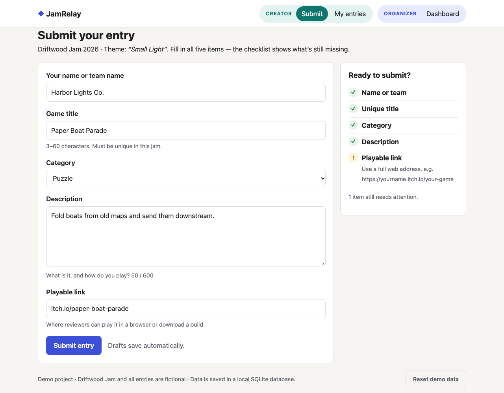
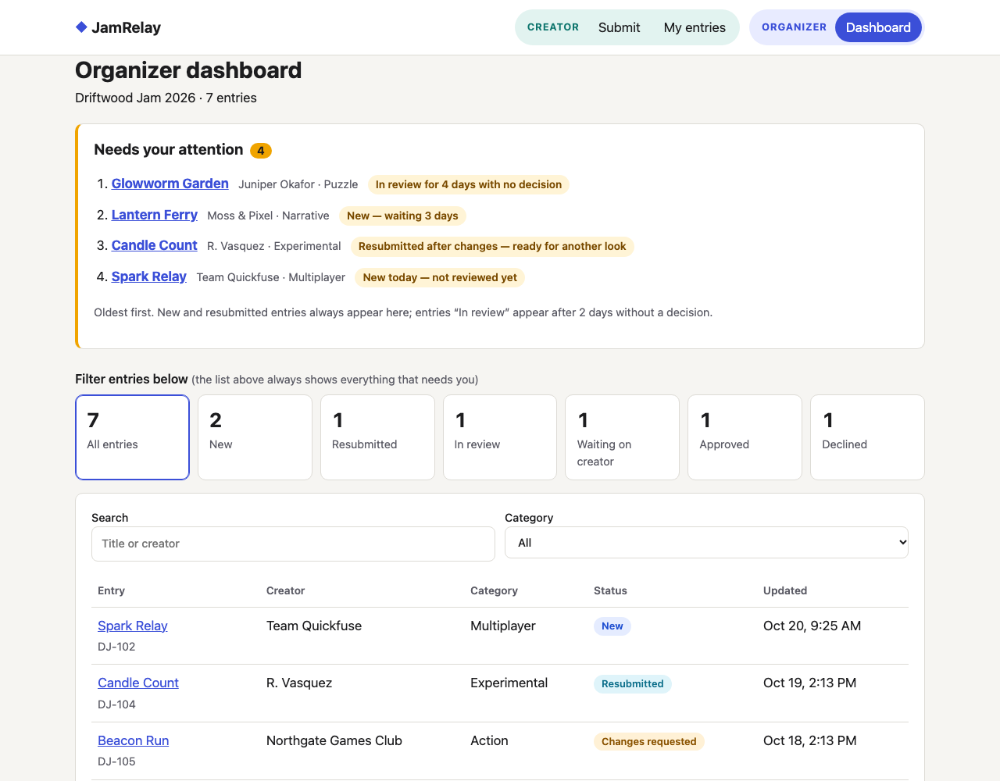

# JamRelay

A small submission and review tool for a game jam. Creators submit their game. The organizer reviews entries, changes their status and leaves feedback. A dashboard shows which entries need attention.

The jam ("Driftwood Jam 2026"), the creators and the entries are all fictional.

**Why I built it, what I left out and how I tested it: [WRITEUP.md](WRITEUP.md)**

| Creator: the live "Ready to submit?" checklist | Organizer: what needs attention, oldest first |
|---|---|
|  |  |

## The idea

JamRelay doesn't try to replace a full jam platform or handle judging. It focuses on one narrow step: **the handoff between a creator submitting and an organizer deciding.** It catches incomplete entries before they're sent, and it makes sure no entry sits without a decision.

This is a **hypothesis**, based on my assumptions about how small jams are run. I haven't interviewed organizers yet. That's the next step, and it could change the focus.

## Two-minute walkthrough

1. **Submit** (Creator): fill in the form, using a link like `itch.io/my-game`. The checklist flags the link and shows the right format. Fix it and submit.
2. **Dashboard** (Organizer): your entry now appears in "Needs your attention", with the reason it's there.
3. Open your entry and choose *Changes requested*. The app won't save the decision without feedback.
4. **My entries** (Creator): read the feedback, edit the entry and resubmit. It goes back into the organizer's queue, marked as resubmitted.

**Demo limitations:** there are no accounts. Anyone can open the organizer dashboard, and "My entries" only lists entries submitted from the current browser. Everything is fictional, and data stays in a local SQLite file.

## My role and how I used AI

- **Product decisions:** I chose the problem, what to leave out, and the acceptance criteria, working from options an AI assistant (Claude) proposed. I also made the design calls, such as splitting the app into separate Creator and Organizer areas.
- **Code and tests:** a mix. I wrote or changed some parts, and Claude wrote the rest, including most of the tests.
- **Feedback so far is AI-assisted:** a separate AI reviewer tested the app. I chose which findings to act on, and Claude made the fixes. Testing with real organizers and creators is still to do ([WRITEUP.md](WRITEUP.md), section 5).

## Run it

You need Python 3.8 or newer. There is nothing to install.

```sh
python3 server.py
```

Then open <http://localhost:8000>. The app creates a SQLite database at `data/jamrelay.db` and fills it with demo entries. To start over, use **Reset demo data** at the bottom of any page.

## What you can do

| As a… | You can… |
|---|---|
| Creator | Submit a title, category, description and playable link. A live checklist shows what's missing before you submit. Your draft is saved as you type. |
| Creator | Open **My entries** to see each entry's status and the organizer's feedback. If changes were requested, you can edit the entry and resubmit it. |
| Organizer | Use the **Dashboard**. It shows a "Needs your attention" list (oldest first), status tiles that filter the table, and search plus a category filter. |
| Organizer | Open an entry and move it to *In review*, *Changes requested*, *Approved* or *Declined*. Feedback is required when you request changes or decline. Every step is kept in the entry's history. |

## How it fits together

```
Browser (index.html, js/)  ── JSON over HTTP ──>  API (server.py)  ── SQL ──>  SQLite (data/jamrelay.db)
```

| File | Role |
|---|---|
| `js/rules.js` | Validation, allowed status changes and "needs attention" logic. Pure functions with no page or network code. |
| `js/store.js` | The browser's data layer. It calls the API and keeps a copy of the entries for the page. |
| `js/app.js` | The screens and the router (`#/submit`, `#/mine`, `#/dashboard`, `#/review/:id`). |
| `server.py` | Serves the app and the JSON API. It re-checks the same rules as `rules.js` and stores the data in SQLite. |

### API

| Method & path | Does |
|---|---|
| `GET /api/entries` | Lists all entries, each with its history |
| `GET /api/entries/:id` | Returns one entry |
| `POST /api/entries` | Creates an entry: `201` on success, or `400 {errors: {field: message}}` |
| `PUT /api/entries/:id` | Creator edit and resubmit. Only allowed while the entry is *Changes requested* (`409` otherwise) |
| `POST /api/entries/:id/review` | Organizer decision `{status, feedback}`: `400` if the move isn't allowed or required feedback is missing |
| `POST /api/reset` | Restores the demo data |

## Tests

```sh
python3 -m unittest discover -s tests -v   # API + database: 23 tests
./tests/run.sh                             # rules in the terminal (macOS): 23 tests
```

With the server running, you can also open these pages:

- <http://localhost:8000/tests/index.html>: the same rule tests, run in the browser
- <http://localhost:8000/tests/smoke.html>: an end-to-end test that drives the real app from submission through review, requested changes and resubmission to approval (34 checks). **It resets the demo data.**
